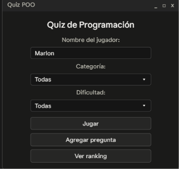
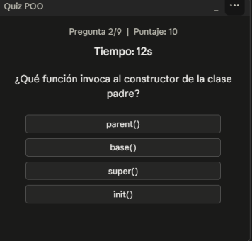
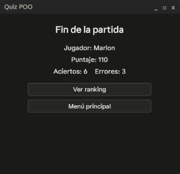
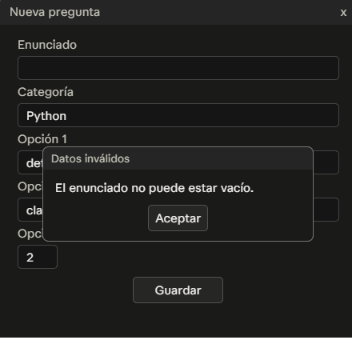

# Quiz de Programación

Juego de preguntas y respuestas con interfaz gráfica, desarrollado en Python con Programación Orientada a Objetos.

## Descripción del problema
Estudiar conceptos de programación suele ser monótono. Esta aplicación convierte el repaso en un juego con categorías, niveles de dificultad, tiempo límite y puntaje, para practicar de forma activa.

## Objetivos
- Permitir jugar partidas de preguntas filtradas por categoría y dificultad.
- Medir el desempeño con puntaje, aciertos, errores y ranking.
- Demostrar la aplicación de los conceptos de POO vistos en el semestre.

## Funcionalidades
1. **Jugar una partida** eligiendo categoría y dificultad.
2. **Temporizador** de 15 segundos por pregunta; si se agota, cuenta como error.
3. **Resultados y ranking** de la sesión (en memoria).
4. **Agregar preguntas** desde la interfaz, con validación de datos.

## Tecnologías utilizadas
- Python 3.10 o superior
- Tkinter (incluido con Python) para la interfaz
- `abc` para clases abstractas
- pytest para las pruebas

## Instalación
```bash
git clone <URL_DEL_REPOSITORIO>
cd quiz_poo
python -m venv .venv
# Windows: .venv\Scripts\activate    |  Linux/Mac: source .venv/bin/activate
pip install -r requirements.txt
```
> Tkinter ya viene con Python en Windows y macOS. En Linux: `sudo apt install python3-tk`.

## Ejecución
```bash
python main.py
```
Pruebas: `pytest pruebas`

## Manual de usuario
1. **Menú principal:** escribe tu nombre, elige categoría y dificultad y pulsa *Jugar*.
   
2. **Pregunta:** responde con los botones antes de que termine el tiempo.
   
3. **Resultados:** al terminar verás puntaje, aciertos y errores.
   
4. **Agregar pregunta:** desde el menú, completa el formulario. Si hay campos vacíos o datos inválidos, la app muestra un mensaje de error.
   

## Estructura del proyecto
```
quiz_poo/
├── main.py                       # punto de entrada
├── modelos/
│   ├── pregunta.py               # clase abstracta Pregunta
│   ├── pregunta_multiple.py      # PreguntaMultiple (hereda de Pregunta)
│   └── pregunta_vf.py            # PreguntaVerdaderoFalso (hereda de Pregunta)
├── servicios/
│   ├── gestor_preguntas.py       # GestorPreguntas y preguntas iniciales
│   ├── partida.py                # lógica y estado de la partida
│   └── ranking.py                # ranking en memoria
├── interfaz/
│   └── ventana_principal.py      # interfaz Tkinter, eventos y callbacks
├── pruebas/test_quiz.py
├── docs/INFORME_TECNICO.md
├── requirements.txt
└── README.md
```

## Autor
Marlon Aragon Ponce — Corporación Universitaria Americana
