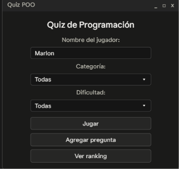
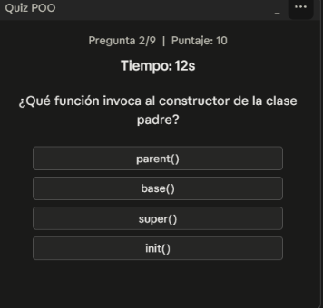
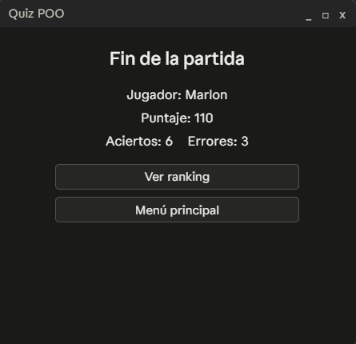
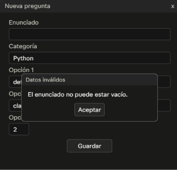

# Informe técnico — Quiz de Programación

## 1. Análisis del problema
**Necesidad:** repasar conceptos de programación de forma dinámica.
**Público objetivo:** estudiantes de programación.
**Funcionalidades:** jugar por categoría y dificultad, temporizador, resultados con ranking y agregar preguntas.
**Limitaciones:** los datos viven solo en memoria (no hay persistencia, según el enunciado) y solo se pueden agregar preguntas de selección múltiple desde la interfaz.

## 2. Diseño inicial
Se identificaron las siguientes clases y responsabilidades:

| Clase | Responsabilidad |
|---|---|
| `Pregunta` (abstracta) | Contrato común y validación de enunciado, categoría y dificultad |
| `PreguntaMultiple` | Pregunta con varias opciones y una correcta |
| `PreguntaVerdaderoFalso` | Pregunta de dos opciones fijas |
| `GestorPreguntas` | Almacenar y filtrar preguntas |
| `Partida` | Estado del juego: turno, puntaje, aciertos y errores |
| `Ranking` | Registrar y ordenar puntajes de la sesión |
| `VentanaPrincipal` | Mostrar la interfaz y reaccionar a eventos |

## 3. Arquitectura
El código se separa en tres capas:
- **modelos:** entidades del dominio (`Pregunta` y subclases).
- **servicios:** lógica de aplicación (`GestorPreguntas`, `Partida`, `Ranking`).
- **interfaz:** presentación en Tkinter.

La interfaz solo invoca métodos de los servicios y muestra el resultado. Nunca decide puntajes ni validez de respuestas. Ejemplo: el temporizador corre en la interfaz (`after()`), pero la consecuencia de agotar el tiempo la define `Partida.tiempo_agotado()`.

## 4. Diagrama de clases
```
Pregunta (ABC)
 ├── PreguntaMultiple
 └── PreguntaVerdaderoFalso

GestorPreguntas  o----> Pregunta        (agregación)
Partida          ----> Pregunta        (usa las preguntas seleccionadas)
VentanaPrincipal ----> GestorPreguntas, Partida, Ranking   (asociación)
```

## 5. Aplicación de POO

| Concepto | Clase o método | Archivo | Explicación |
|---|---|---|---|
| Clases y objetos | `Partida`, `GestorPreguntas`, `Ranking` | `servicios/` | Cada una con una responsabilidad definida e instanciadas desde la interfaz |
| Encapsulamiento | `Pregunta.enunciado`, `categoria`, `dificultad` (`@property` con setter) | `modelos/pregunta.py` | Rechazan valores vacíos o inválidos con `ValueError` |
| Encapsulamiento | `Partida.puntaje` (solo lectura) | `servicios/partida.py` | La interfaz no puede alterar el puntaje |
| Herencia | `PreguntaMultiple`, `PreguntaVerdaderoFalso` | `modelos/` | Reutilizan atributos y validaciones vía `super().__init__()` y especializan `opciones` y `evaluar()` |
| Polimorfismo | `evaluar()` y `opciones` | `modelos/`, `servicios/partida.py` | `Partida.responder()` y la interfaz tratan igual a cualquier pregunta |
| Abstracción | `Pregunta` con `@abstractmethod` | `modelos/pregunta.py` | Contrato: toda pregunta expone `opciones` y `evaluar()` |
| Agregación | `GestorPreguntas` y `Pregunta` | `servicios/gestor_preguntas.py` | Las preguntas existen sin el gestor |
| Composición | `Partida` y su estado (puntaje, aciertos, errores) | `servicios/partida.py` | El estado se crea y termina con la partida |
| Asociación | `VentanaPrincipal` con `Partida`, `GestorPreguntas`, `Ranking` | `interfaz/ventana_principal.py` | La interfaz colabora con la lógica |

Fragmento del polimorfismo:
```python
correcta = pregunta.evaluar(indice)   # Multiple o VF, Partida no distingue
```

## 6. Construcción de la interfaz
- **Biblioteca:** Tkinter (con `ttk`), por venir incluida en Python y no agregar dependencias.
- **Diseño:** una sola ventana que cambia de marco: menú, pregunta, resultados y ranking. El formulario de nueva pregunta es una ventana secundaria.
- **Controles:** `Entry`, `Combobox`, `Button` y `Label`.
- **Eventos y callbacks:** los botones usan `command=` (`_iniciar`, `_responder`, `_dialogo_agregar`) y el temporizador usa `after()` con `_tick`.
- **Comunicación con las clases:** la interfaz crea `Partida`, llama `responder()` o `tiempo_agotado()` y lee `puntaje`, `aciertos` y `errores`.
- **Capturas:**




## 7. Proceso de desarrollo
1. Formulación de la idea: juego de preguntas con temporizador.
2. Identificación de funcionalidades: jugar, temporizador, resultados y agregar preguntas.
3. Diseño de clases: jerarquía de `Pregunta` y servicios.
4. Construcción de la lógica: modelos, gestor, partida y ranking.
5. Desarrollo de la interfaz en Tkinter.
6. Integración de la interfaz con los servicios.
7. Pruebas y correcciones.

## 8. Pruebas

| Prueba | Acción realizada | Resultado esperado | Resultado obtenido |
|---|---|---|---|
| 1. Polimorfismo | Evaluar una `PreguntaMultiple` y una `PreguntaVerdaderoFalso` con `evaluar()` | Ambas responden correctamente según su tipo | Correcto (pytest) |
| 2. Partida | Responder bien una pregunta de dificultad media y agotar el tiempo en otra | Puntaje 20, 1 error, partida terminada | Correcto (pytest) |
| 3. Entradas inválidas | Enunciado vacío, opción correcta fuera de rango, agregar un objeto que no es pregunta e instanciar la clase abstracta | `ValueError` o `TypeError` en cada caso | Correcto (pytest) |

Prueba manual recomendada: en el formulario "Agregar pregunta", dejar el enunciado vacío y verificar que aparece el mensaje de error.

## 9. Problemas y soluciones
> Ajusta esta sección con las dificultades que realmente viviste. Estos son dos ejemplos coherentes con el código.

1. **El temporizador seguía corriendo después de responder.** *Diagnóstico:* `after()` programa una llamada futura que se ejecuta aunque el usuario ya haya contestado, lo que podía descontar tiempo o registrar un error doble. *Solución:* guardar el identificador devuelto por `after()` y cancelarlo con `after_cancel()` al responder o cambiar de pantalla (`_cancelar_timer`).
2. **Entradas inválidas en el formulario de nueva pregunta.** *Diagnóstico:* un número no válido o campos vacíos rompían el flujo. *Solución:* validar dentro de las clases (`ValueError` en los setters y constructores) y capturar la excepción en la interfaz para mostrar un mensaje, sin duplicar reglas en la ventana.

## 10. Conclusiones
Se aplicaron abstracción, herencia, polimorfismo, encapsulamiento y relaciones entre objetos de forma funcional. Separar modelos, servicios e interfaz facilitó probar la lógica sin abrir ventanas. Como mejoras futuras: persistir preguntas y ranking en archivo, permitir agregar preguntas de verdadero o falso desde la interfaz y añadir niveles de tiempo según la dificultad.
